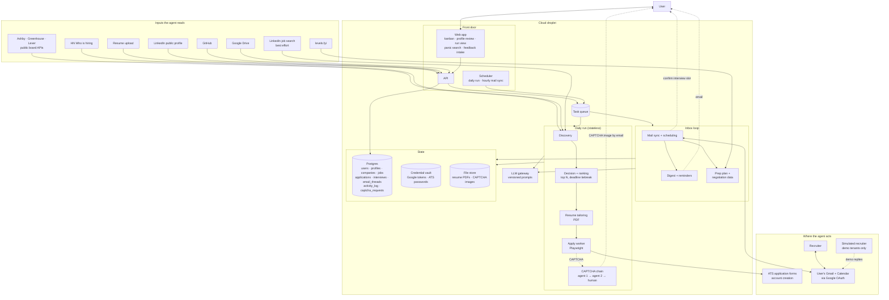
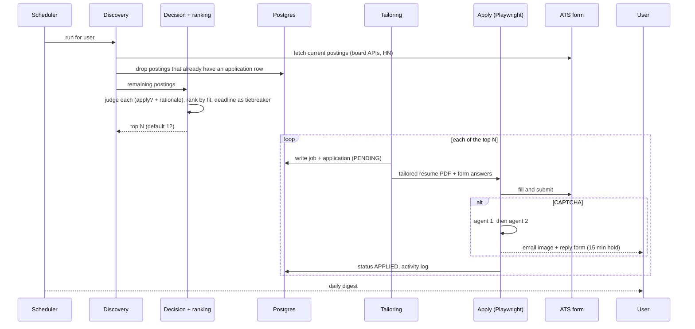
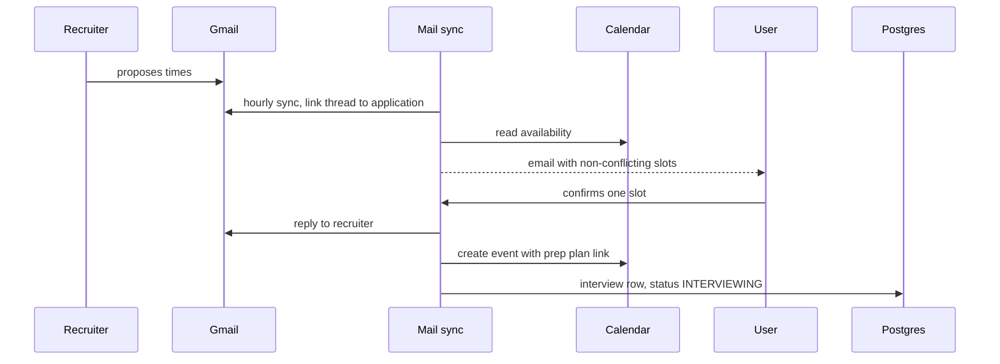

# Architecture

Companion to [PRD.md](PRD.md) v1.1. Everything runs on one cloud droplet. The daily run is stateless: it queries, ranks, applies to the top N and stores only what it applied to.

## System diagram

Rendered copy for slides: [architecture.png](architecture.png). Regenerate with `npx -y @mermaid-js/mermaid-cli -i docs/ARCHITECTURE.md -o docs/architecture.png` after editing the Mermaid source below.

## Daily run

## Scheduling an interview

## Boundaries

- **Read-only sources:** LinkedIn public profile and job search, GitHub, HN, the three ATS board APIs, levels.fyi.
- **Writes on the user's behalf:** ATS application forms and ATS account creation, Gmail sends (scheduling and follow-ups only), Calendar events.
- **Never automated:** booking an interview without the user's confirmed slot, any message involving compensation, voluntary self-identification fields, LinkedIn or Indeed logged-in applying.
- **Tenant isolation:** every table carries `tenant_id`; vault keys are per tenant; the simulated recruiter is enabled by a tenant flag and never for real tenants.
